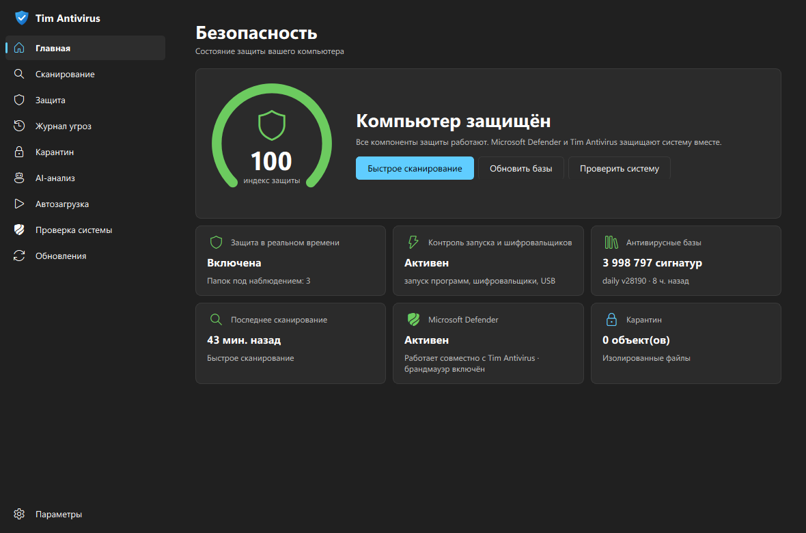
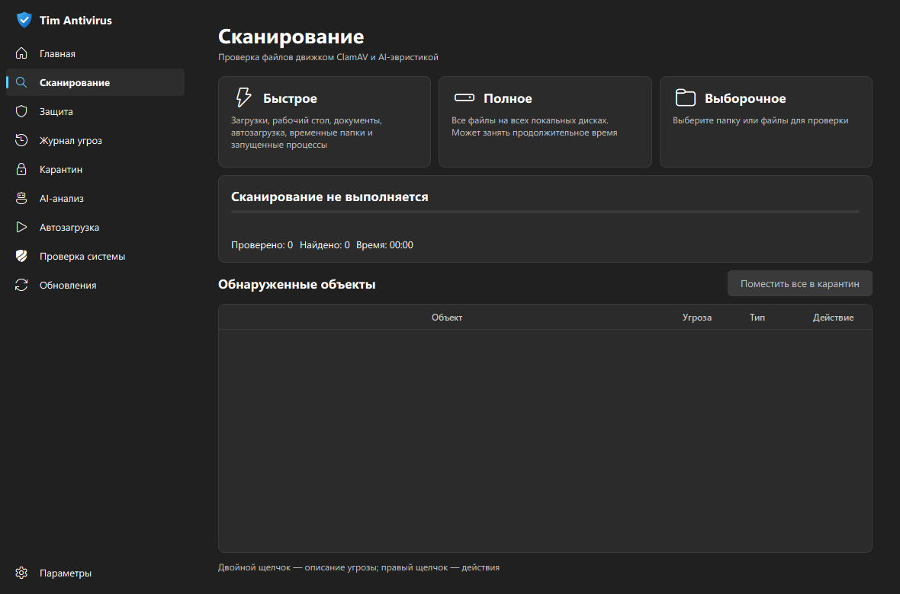
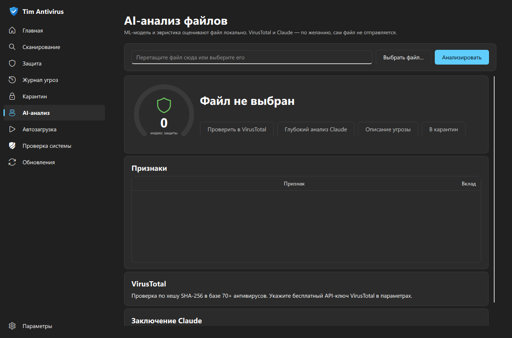
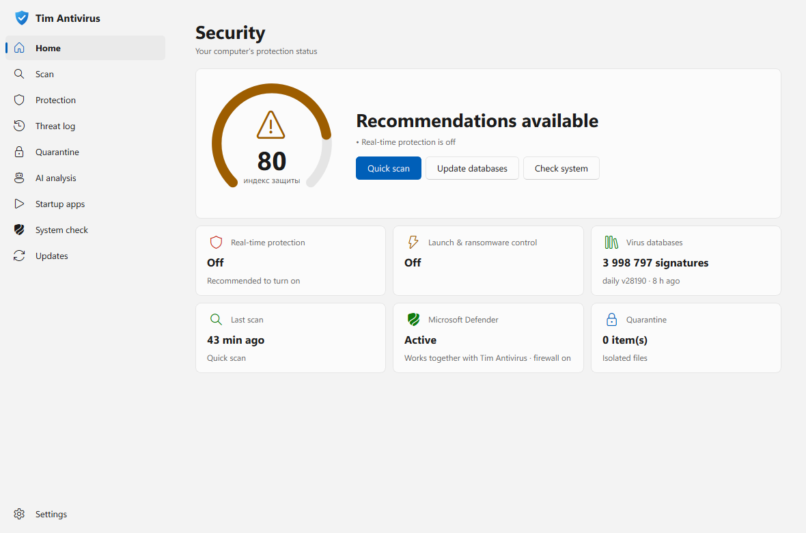

# Tim Antivirus

Десктопный антивирус для Windows 11 на Python + PySide6 с движком **ClamAV 1.5**.
Работает **вместе** с Microsoft Defender и никогда его не отключает (статус Defender только читается).

| | |
|---|---|
|  |  |
|  |  |

## Возможности

| Функция | Реализация |
|---|---|
| Быстрое / полное / выборочное сканирование | `timav/core/scanner.py` — обход дисков, пауза/отмена, прогресс, 4 потока |
| Обнаружение вирусов ClamAV | `timav/core/clamav.py` — резидентный `clamd` (INSTREAM по TCP 127.0.0.1:33110), запасной режим `clamscan` |
| Мониторинг в реальном времени | `timav/core/monitor.py` — watchdog (ReadDirectoryChangesW), проверка после записи, автокарантин |
| Журнал угроз | `timav/core/journal.py` — SQLite, фильтр, поиск, экспорт CSV |
| Карантин | `timav/core/quarantine.py` — XOR-обфускация, восстановление, удаление |
| Уведомления | значок в трее + всплывающие уведомления Windows |
| AI-анализ | `timav/core/ai_analyzer.py` — локальная модель (~30 статических признаков PE/скриптов → логистическая оценка риска) + необязательный облачный анализ Claude (`claude-opus-5-5`, отправляются только признаки, не файл) |
| Индикатор безопасности | `timav/core/system_status.py` — индекс 0–100: базы, мониторинг, угрозы, сканирование, Defender, брандмауэр |
| Автообновление баз | `timav/core/updater.py` — `freshclam`, интервал 1–24 ч |
| Интерфейс Windows 11 | `timav/ui/` — навигационная панель, карточки, переключатели Fluent, Segoe Fluent Icons, светлая/тёмная тема, тёмный заголовок окна через DWM |

### Версия 1.1

| Функция | Реализация |
|---|---|
| Контроль запуска программ | `core/process_guard.py` — новые процессы обнаруживаются опросом (~0,5 с), заражённые завершаются и изолируются. Без драйвера ядра запуск нельзя остановить *до* старта — процесс успевает проработать доли секунды |
| Защита от шифровальщиков | `core/ransomware.py` — скрытые файлы-ловушки + контроль массового шифрования/переименования. Процесс приостанавливается только при прямом доказательстве (держит открытыми файлы в защищаемых папках) или если это новый неподписанный процесс; иначе — только предупреждение |
| Проверка флешек | `core/devices.py` — сканирование съёмных носителей при подключении |
| Проверка загрузок | `core/downloads.py` — уведомление «загрузка проверена» + источник из Mark-of-the-Web |
| Автозагрузка | `core/autoruns.py` — Run/RunOnce, папки автозагрузки, задачи, службы; подпись (в т.ч. каталожная), ClamAV, AI; обратимое отключение |
| Меню Проводника | `core/shell.py` — «Проверить в Tim Antivirus» (в Windows 11 — «Показать дополнительные параметры») |
| VirusTotal | `core/virustotal.py` — проверка по SHA-256, файл не отправляется |
| ML-модель | `core/ml_model.py` — Random Forest (60 деревьев), обучена `tools/train_model.py` на открытом датасете ClaMP (5184 PE): точность 97,8 % (5-fold CV), ложные срабатывания на 860 чистых программах этого ПК — 0–0,6 % |
| Доверенные издатели | `core/signer.py` — WinVerifyTrust + издатель из сертификата; редактируемый список |
| Описания угроз | `core/threat_info.py` — категория, опасность, семейство, советы; по желанию — объяснение Claude |
| Отчёты | `core/report.py` — PDF/HTML для сканирования, журнала и проверки системы |
| Мини-окно из трея | `ui/flyout.py` — статус, переключатели, быстрая проверка (левый щелчок по значку) |
| Обновление программы | `core/selfupdate.py` — канал `github:owner/repo` или JSON-манифест, проверка SHA-256, тихая установка |
| Английский язык | `i18n.py` + `i18n_en.py` (620 строк), тест проверяет, что переведена каждая строка |
| Проверка системы | `core/posture.py` — UAC, Secure Boot, BitLocker, целостность памяти, обновления, RDP, SMBv1 и др. Только чтение |
| Подпись сборки | `build.ps1` — `TIMAV_SIGN_PFX` / `TIMAV_SIGN_THUMBPRINT` → signtool для exe, установщика и деинсталлятора |

> Эвристика (признаки + ML-модель) помечает файлы как «подозрительные», а не «вирусы»; решение остаётся за пользователем.
> Отчёты PDF/HTML пока формируются только на русском.

## Установка

Скачайте `TimAntivirus-Setup-*.exe` со страницы [Releases](https://github.com/tymurius2-arch/tim-antivirus/releases)
и запустите. Установщик не подписан сертификатом, поэтому SmartScreen может показать предупреждение
(«Подробнее» → «Выполнить в любом случае»). Контрольная сумма SHA-256 приложена к релизу.

Обновления программы: «Параметры» → «Обновление программы» → канал `github:tymurius2-arch/tim-antivirus`.

## Разработка

```powershell
python -m venv .venv
.\.venv\Scripts\pip install -r requirements.txt
powershell -ExecutionPolicy Bypass -File tools\get_clamav.ps1   # официальная сборка ClamAV в vendor\clamav
.\.venv\Scripts\python -m timav
```

Данные пользователя: `%LOCALAPPDATA%\TimAntivirus` (базы, карантин, журнал, настройки, `logs\app.log`).

## Тесты

```powershell
.\.venv\Scripts\python -m pytest            # 44 теста: ClamAV, clamd, сканер, монитор, карантин, журнал, AI, ML,
                                            # контроль запуска, шифровальщики, автозагрузка, обновление, UI, перевод
.\.venv\Scripts\python -m pytest -m realdb  # EICAR против официальных баз (передаётся из памяти, на диск не пишется)
```

Для обнаружения в тестах используется собственная тестовая сигнатура (`.hdb`) на случайных данных — без настоящих
вредоносов и без EICAR-файлов на диске, чтобы не мешать Microsoft Defender.

## Сборка установщика

```powershell
.\build.ps1          # тесты → PyInstaller → Inno Setup 6 → dist\TimAntivirus-Setup-<версия>.exe (+ .sha256)
```

Подпись кода: задайте `TIMAV_SIGN_PFX` (+ `TIMAV_SIGN_PASSWORD`) или `TIMAV_SIGN_THUMBPRINT`.

## Лицензии

Код проекта — MIT (см. [LICENSE](LICENSE)). ClamAV® — GPL-2.0, © Cisco Systems (исходники:
https://github.com/Cisco-Talos/clamav). Qt/PySide6 — LGPL-3.0. ML-модель обучена на датасете
[ClaMP](https://github.com/urwithajit9/ClaMP).
